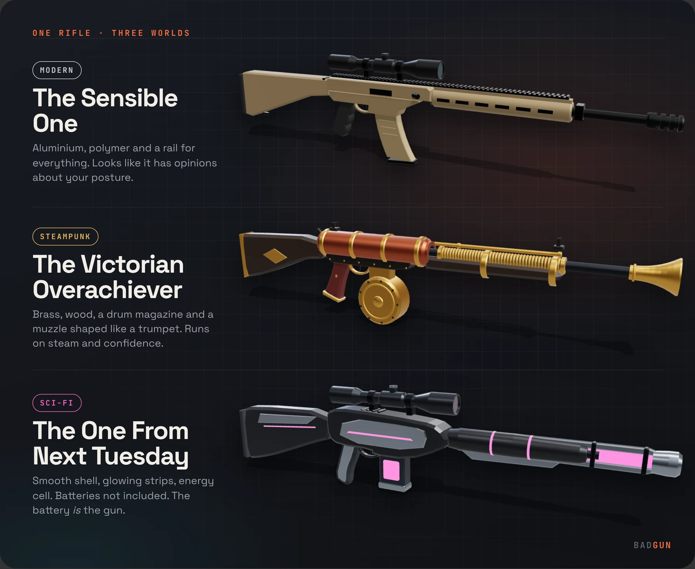

<p align="center">
  
</p>

<h1 align="center">BadGun</h1>

<p align="center">
  <b>Procedural, game-ready weapon assets.</b><br>
  Archetype + style + seed = a reproducible, coherent, already-painted 3D weapon (<code>.glb</code>).
</p>

<p align="center">
  <a href="devlog/README.md">📓 Devlog</a> ·
  <a href="#quick-start">🚀 Quick start</a> ·
  <a href="examples/">📦 Example .glb files</a> ·
  <a href="docs/ARCHITECTURE.md">🧠 Architecture</a> ·
  <a href="docs/PROJECT_BRIEF.md">📜 Brief</a>
</p>

---

> **New here and not a programmer?** Start with the devlog: [**#001: The Gun Factory Is Open**](devlog/001-the-gun-factory-is-open.md). It explains everything with pictures and zero jargon.

## What it does

- **One blueprint, many worlds.** The archetype (rifle) owns proportions; the style (modern, steampunk, sci-fi) owns design language, part choices and palettes. They're independent, so new styles work with every archetype.
- **Deterministic.** Same recipe + seed gives a byte-identical `.glb`. Every decision draws from a *named* random stream, so tweaking the stock never reshuffles the barrel.
- **Painted on arrival.** Style-appropriate PBR materials (base color, metallic, roughness, emissive, glass), with multiple palette variants per style.
- **Easy to texture.** 11 semantic material slots (`MAT_Body`, `MAT_Grip`, `MAT_Stock`, `MAT_Barrel`, `MAT_Trim`, `MAT_Glass`, `MAT_Emissive`, …), shared across parts and stable across regenerations. Recolor any slot without touching geometry.
- **UVs included.** Every part gets a physical unwrap with constant texel density (1 UV unit = 0.25 m), which suits tiling materials and trim sheets.
- **Game-ready hierarchy.** Named components on correct pivots, moving parts with motion metadata (magazine → reload, trigger → fire, stock → adjust, hammer → cock), and sockets for hands, optics, muzzle FX, ejection and the ADS camera.
- **Engine-agnostic.** Plain glTF 2.0 binary with zero runtime dependencies. A sidecar manifest JSON (also embedded in the `.glb` extras) carries the recipe, parts, sockets, bounds, collision box and stats.

## Quick start

```bash
npm install
npm run build
```

Generate a weapon (writes a `.glb` plus a manifest `.json` to `out/`):

```bash
node dist/cli.js --style steampunk --seed 4
```

Ten variants with consecutive seeds:

```bash
node dist/cli.js --style scifi --seed 1 --count 10
```

Art direction, part swaps and recoloring:

```bash
node dist/cli.js --style modern --seed 7 --param bulk=0.9 --param wear=0.6 --optic scope --part magazine=drum --color Body=#3a5f8a
```

See every style, palette and part variant:

```bash
node dist/cli.js --list
```

### Live 3D preview

```bash
npm run preview
```

Open the printed URL for real-time generation with style buttons, seed stepping, art-direction sliders, part swapping, per-slot color pickers (recolor without rebuilding), material isolation, exploded view, socket gizmos, and `.glb`/recipe export.

### As a library

```js
import { generate, toGLB, buildManifest } from 'badgun';

const weapon = generate({
  archetype: 'rifle',
  style: 'steampunk',
  seed: 42,
  params: { ornament: 1, wear: 0.3 },        // optional, 0..1. Unset ones come from the seed
  parts: { magazine: 'drum' },                // optional part overrides
  palette: { Stock: '#2a1d16' },              // optional per-slot recolor
});
const bytes = toGLB(weapon);                  // Uint8Array, ready for fs.writeFileSync or a browser download
const manifest = buildManifest(weapon);       // sockets, parts, materials, bounds, stats
```

## Recipes

A recipe is the whole description of a weapon. Save it, share it, batch it:

```json
{
  "archetype": "rifle",
  "style": "steampunk",
  "seed": 4,
  "params": { "length": 0.8, "bulk": 0.6, "ornament": 0.9, "detail": 0.7, "smoothness": 0.8, "wear": 0.2 },
  "optic": "auto",
  "paletteVariant": 1,
  "parts": { "muzzle": "bell" },
  "palette": { "Body": "#b8893a" }
}
```

| Param | 0 | 1 |
|---|---|---|
| `length` | compact | long |
| `bulk` | slim | beefy |
| `ornament` | clean | ornate |
| `detail` | simple | busy |
| `smoothness` | chunky low-poly | smooth |
| `wear` | factory new | battered (materials only) |

## Asset conventions

| | |
|---|---|
| Units | meters |
| Axes | +Y up, +Z forward (muzzle), +X is the weapon's left |
| Origin | trigger hand on the pistol grip (`SOCKET_Hand_Grip`) |
| Materials | one shared `MAT_<Slot>` per semantic slot → at most one draw call per part per slot |
| Sockets | empty nodes `SOCKET_*`, whose +Z axis is the socket direction: `Muzzle`, `Optic`, `ADS`, `Hand_Grip`, `Hand_Support`, `Magazine`, `Eject`, `Shoulder` |
| Moving parts | node `extras.badgun.motion` = `{ type, axis, range, purpose }` |
| Manifest | `<name>.json` sidecar + root node `extras.badgun` |

## What's in v0.1

| Archetypes | Styles | Part variants |
|---|---|---|
| rifle | modern, steampunk, sci-fi | 3 receivers · 6 barrels · 6 muzzles · 3 handguards · 5 stocks · 3 grips · 5 magazines · 5 optics |

Any part works with any style (the style's palette repaints it), so the Frankengun is a supported feature.

**Known limitations:** UV islands can overlap (fine for tiling and trim textures, not yet for unique hand-painted atlases). There are no LODs or animation clips yet, only motion metadata. Only the rifle archetype exists so far. The roadmap lives in the [brief](docs/PROJECT_BRIEF.md#8-practical-milestones-suggested-not-prescribed).

## Development

```bash
npm test          # build + determinism, recolor, socket and glTF-validator tests over 100+ recipes
npm run examples  # regenerate examples/*.glb
```

Batch screenshots (headless Chromium via Playwright) go through `node tools/render.mjs jobs.json`.

---

<p align="center"><sub>A <b>Bad Ideas Works</b> project, where bad ideas receive suspiciously serious engineering.</sub></p>
