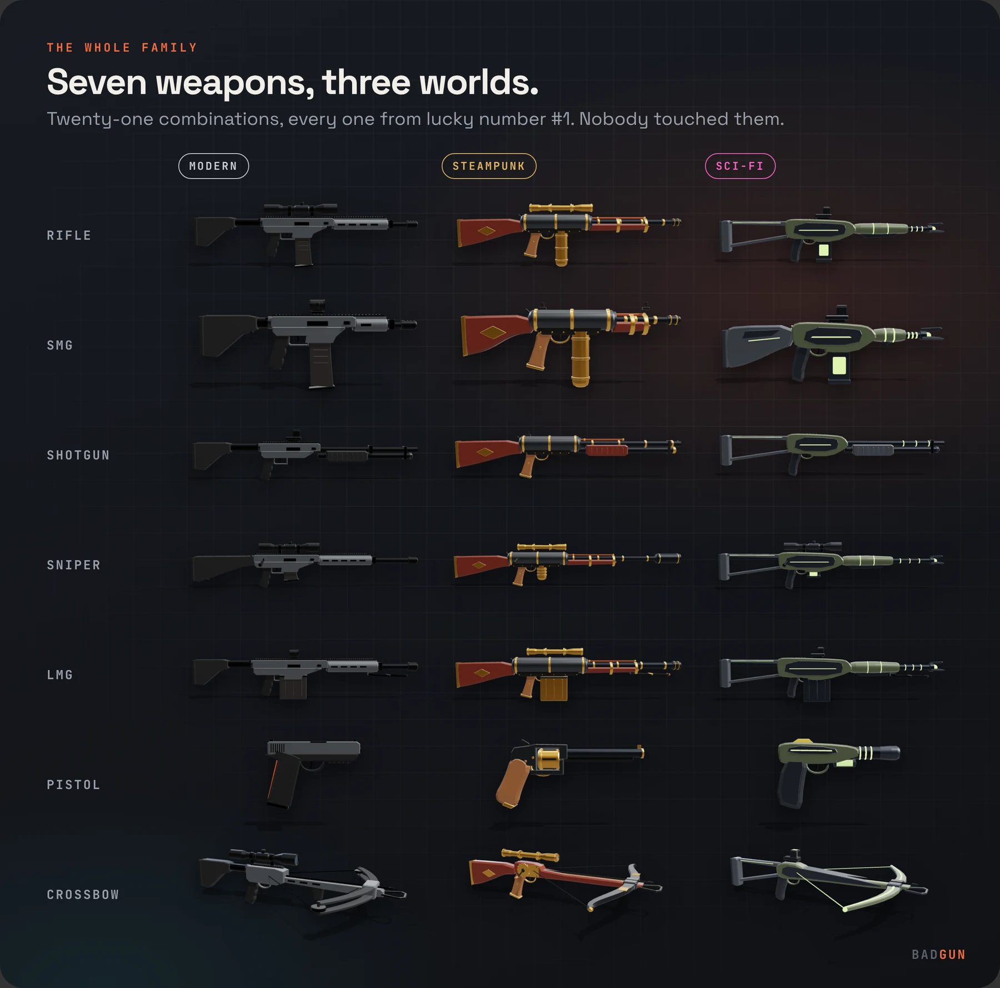

<p align="center">
  
</p>

<h1 align="center">BadGun</h1>

<p align="center">
  <b>Procedural, game-ready weapon assets.</b><br>
  Weapon type + style + seed = a reproducible, coherent, already-painted 3D weapon (<code>.glb</code>).<br>
  Rifles · SMGs · shotguns · snipers · LMGs · pistols · revolvers · crossbows · bows, in modern, steampunk, sci-fi, survivor, fantasy, WW1, WW2, Vietnam-era, dieselpunk and cyberpunk styles.
</p>

<p align="center">
  <a href="https://badsadcode.github.io/BadGun/"><b>🎮 Try the playground</b></a> ·
  <a href="https://badsadcode.github.io/BadGun/devlog/">📓 Devlog</a> ·
  <a href="#quick-start">🚀 Quick start</a> ·
  <a href="examples/">📦 Example .glb files</a> ·
  <a href="docs/ARCHITECTURE.md">🧠 Architecture</a> ·
  <a href="docs/PROJECT_BRIEF.md">📜 Brief</a>
</p>

---

> **Just want to play?** Open the [**playground**](https://badsadcode.github.io/BadGun/), press 🎲 *Surprise me*, and download any gun you like.
>
> **New here and not a programmer?** Read the [**devlog**](https://badsadcode.github.io/BadGun/devlog/). It explains everything with pictures and zero jargon.

## What it does

- **Eight weapon types (archetypes), ten worlds.** The archetype (rifle, SMG, shotgun, sniper, LMG, pistol, revolver, crossbow, bow) owns proportions and what parts it needs; the style (modern, steampunk, sci-fi, survivor, fantasy, WW1, WW2, Vietnam, dieselpunk, cyberpunk) owns design language, part choices and palettes. They're independent, so a new style works with every archetype.
- **Every weapon has its own shape.** Seeded shape genes vary proportions (receiver length/height, grip rake, magazine position, bare barrel, stock drop), and layouts vary too: standard, bullpup, lever action, machine pistol (magazine through the grip) or box-fed shotgun; break-action doubles, one-piece stocks, stockless.
- **Deterministic.** Same recipe + seed gives a byte-identical `.glb`. Every decision draws from a *named* random stream, so tweaking the stock never reshuffles the barrel.
- **Painted on arrival.** Style-appropriate PBR materials (base color, metallic, roughness, emissive, glass), with multiple palette variants per style.
- **Easy to texture.** 11 semantic material slots (`MAT_Body`, `MAT_Grip`, `MAT_Stock`, `MAT_Barrel`, `MAT_Trim`, `MAT_Glass`, `MAT_Emissive`, …), shared across parts and stable across regenerations. Recolor any slot without touching geometry.
- **Two UV sets, ready to texture.** A *tiling* unwrap (1 UV unit = 0.25 m, same density everywhere) for repeating materials and trim sheets, and a non-overlapping *atlas* with uniform texel density for hand painting, baking and unique texture sets.
- **Texture maps on demand.** Bake a base color map, an ID map (one flat color per material slot, for masking in Substance Painter and friends) and a UV template as PNG, or embed the base color texture straight into the `.glb`.
- **Game-ready hierarchy.** Named components on correct pivots, moving parts with motion metadata (magazine → reload, trigger → fire, stock → adjust, hammer → cock), and sockets for hands, optics, muzzle FX, ejection and the ADS camera.
- **Swappable attachments.** Optics, muzzle devices, underbarrel grips and grenade launchers, lights and lasers: on the gun as separate nodes, or as standalone `.glb` assets that snap onto the gun's mount sockets, alone or as a whole kit per world.
- **Animation clips included.** *Fire*, *Reload*, *Cycle* (pump, lever, bolt, rack), *Cock*, *Spin*, *Draw* and accessory clips, built from the weapon's own moving parts, as standard glTF animations. Each comes with timed events (`shot`, `magOut`, `magIn`, …) for syncing sounds and effects.
- **Engine-agnostic.** Plain glTF 2.0 binary with zero runtime dependencies. A sidecar manifest JSON (also embedded in the `.glb` extras) carries the recipe, parts, sockets, bounds, collision box and stats.

## Quick start

```bash
npm install
npm run build
```

Generate a weapon (writes a `.glb` plus a manifest `.json` to `out/`):

```bash
node dist/cli.js --style steampunk --seed 4
```

Other weapon types:

```bash
node dist/cli.js --archetype crossbow --style steampunk --seed 1
```

Ten variants with consecutive seeds:

```bash
node dist/cli.js --style scifi --seed 1 --count 10
```

Art direction, part swaps and recoloring:

```bash
node dist/cli.js --style modern --seed 7 --param bulk=0.9 --param wear=0.6 --optic scope --part magazine=drum --color Body=#3a5f8a
```

See every style, palette and part variant:

```bash
node dist/cli.js --list
```

### Live 3D preview

The same page is online at **https://badsadcode.github.io/BadGun/**. It deploys automatically from `main` via `.github/workflows/pages.yml`. To run it locally:

```bash
npm run preview
```

Open the printed URL for real-time generation with style buttons, seed stepping, art-direction sliders, part swapping, per-slot color pickers (recolor without rebuilding), material isolation, exploded view, socket gizmos, and `.glb`/recipe export.

### As a library

```js
import { generate, toGLB, buildManifest } from 'badgun';

const weapon = generate({
  archetype: 'rifle',
  style: 'steampunk',
  seed: 42,
  params: { ornament: 1, wear: 0.3 },        // optional, 0..1. Unset ones come from the seed
  parts: { magazine: 'drum' },                // optional part overrides
  palette: { Stock: '#2a1d16' },              // optional per-slot recolor
});
const bytes = toGLB(weapon);                  // Uint8Array, ready for fs.writeFileSync or a browser download
const manifest = buildManifest(weapon);       // sockets, parts, materials, bounds, stats
```

## Texturing

Every exported `.glb` carries two UV sets:

| UV set | What it is | Use it for |
|---|---|---|
| **Tiling** (`TEXCOORD_0` by default) | Physical unwrap: 1 UV unit = 0.25 m on every surface. Islands may overlap. | Repeating materials, trim sheets, triplanar-style looks |
| **Atlas** (`TEXCOORD_1` by default) | Every surface packed once into the 0..1 square, no overlaps, uniform texel density (about 11 px/cm at 1024, 22 px/cm at 2048 on a rifle) | Hand painting, AO/lightmap baking, unique texture sets |

```bash
node dist/cli.js --style diesel --seed 3 --maps 2048 --uv atlas
```

`--maps` writes `_BaseColor.png` (the palette baked into the atlas), `_ID.png` (one flat color per material slot, see `ID_COLORS`) and `_UVTemplate.png` (island outlines to paint over). `--uv atlas` puts the atlas first, which is what most painting tools read. `--texture` embeds the base color map in the `.glb`, so the model opens already textured and ready to paint over. The playground has the same options, plus a **Checker** view and a **UV map** panel.

```js
import { generate, toGLB, bakeTexture, encodePNG } from 'badgun';
const weapon = generate({ archetype: 'rifle', style: 'cyber', seed: 4 });
const glb = toGLB(weapon, { uv: 'atlas', texture: 1024 });   // textured, atlas in TEXCOORD_0
const id = bakeTexture(weapon, 'id', { size: 2048 });        // { width, height, data: RGBA }
const png = encodePNG(id.data, id.width, id.height);         // Uint8Array, write it anywhere
```

## Attachments

Attachments come two ways.

**On the gun.** Long guns have two more part kinds, `underbarrel` (`vgrip`, `angled`, `stubby`, `launcher`) and `side` (`flashlight`, `laser`, `combo`, `lantern`, `crystal`, `taped`). Pistols with a rail-like frame get `underbarrel` lights and lasers. Each world picks what suits it, mostly picking *none*: lanterns for steampunk, glowing crystals for fantasy, duct-taped flashlights for survivors, no lasers in WW2. Each attachment is its own node (`Underbarrel`, `SideAttachment`, `Optic`, `Muzzle`), so a game can hide or swap it.

```bash
node dist/cli.js --style modern --seed 2 --part underbarrel=launcher --part side=flashlight
```

**Standalone, to swap at runtime.** Every weapon has mount sockets: `SOCKET_Optic`, `SOCKET_Barrel_End`, `SOCKET_Underbarrel` and `SOCKET_Side`. A standalone attachment's origin is its own `SOCKET_Mount`, so snapping it on is a plain translation (everything keeps +Y up and +Z forward). A standalone attachment is built exactly like the mounted one (the tests check that the geometry matches), sized for a rifle by default (`host` picks another weapon type).

```bash
node dist/cli.js --attachment underbarrel --variant launcher --style cyber --seed 2
node dist/cli.js --kit --style steampunk --seed 4      # every attachment that suits the world + one *_kit.glb
```

```js
import { generateAttachment, generateAttachmentKit, kitToGLB, attachmentVariants } from 'badgun';
const scope = generateAttachment({ type: 'optic', variant: 'scope', style: 'modern', seed: 8 });
const kit = generateAttachmentKit({ style: 'scrap', seed: 3 });   // kit.items: Weapon[]
attachmentVariants('side', 'steampunk');                            // { lantern: 1 }
```

| Type | Snaps onto | Variants |
|---|---|---|
| `optic` | `SOCKET_Optic` | reddot, scope, holo, brass, tube, rune, lamp, smart |
| `muzzle` | `SOCKET_Barrel_End` | 15 devices, from suppressors and brakes to soda cans and crystals |
| `underbarrel` | `SOCKET_Underbarrel` | vgrip, angled, stubby, launcher |
| `side` | `SOCKET_Side` (pistols: `SOCKET_Underbarrel`, turned to hang down) | flashlight, laser, combo, lantern, crystal, taped |

Attachments carry their own sockets too: `SOCKET_Light`, `SOCKET_Laser`, `SOCKET_Launcher_Muzzle`, and `SOCKET_Hand_Support` on grips.

## Animation clips

Every single-weapon `.glb` carries the clips that fit its parts (a pump shotgun gets *Cycle* as a pump, a bolt-action gets a bolt, a revolver gets *Spin*):

| Clip | What moves |
|---|---|
| `Fire` | trigger, hammer, cylinder, slide/toggle recoil; bows and crossbows release the string and launch the projectile |
| `Reload` | magazine out and in, then charging handle/slide/bolt/lever; break actions swing open; crossbows wind the crank |
| `Cycle` | the manual action on its own: pump, lever, bolt, or racking the slide/handle |
| `Cock`, `Spin` | thumb the hammer back; spin a revolver's cylinder |
| `Draw` | bows: string and arrow come back, limbs flex (`Fire` starts from its end pose) |
| `BipodDeploy`, `StockFold`, `StockAdjust`, `CarryHandleFold` | accessories |

They animate the existing part nodes (translation/rotation, 60 fps samples, LINEAR), so they play in any engine. Durations and **events** (e.g. `Fire.events.shot = 0.06`, `Reload.events.magOut`, `magIn`, `chambered`) are in the manifest's `animations` list and in each glTF animation's `extras`, ready for sound and muzzle-flash timing. The playground plays them, with slow motion. Leave them out with `toGLB(weapon, { animations: false })` or `--no-anim`.

```js
import { generate, weaponClips } from 'badgun';
weaponClips(generate({ archetype: 'shotgun', style: 'modern', seed: 1, parts: { config: 'standard' } }))
  .map((c) => `${c.name} ${c.duration}s ${JSON.stringify(c.events)}`);
// [ 'Fire 0.32s {"shot":0.06}', 'Cycle 0.46s {"back":0.2,"forward":0.36}' ]
```

## Faction families

One seed, one matching arsenal: a generated name, a signature color and livery, an insignia badge on every weapon, a *doctrine* of preferred parts (soft preferences, so each archetype keeps its own rules), shared proportions and a shared finish.

```bash
node dist/cli.js --faction --style ww2 --seed 4
```

That writes every member's `.glb`, one `*_arsenal.glb` containing the whole lineup (shared materials), and a `*.faction.json` with all recipes.

```js
import { generateFaction, factionToGLB } from 'badgun';
const faction = generateFaction({ style: 'scifi', seed: 3 });
faction.name;                 // e.g. "Armada of the Last Line"
faction.members.map((m) => m.weapon);
const arsenal = factionToGLB(faction);
```

The building blocks are plain recipe fields you can use yourself: `prefer` (soft part preferences), `family` (share shape genes across recipes) and `insignia`.

## Recipes

A recipe is the whole description of a weapon. Save it, share it, batch it. A recipe always gives the same weapon *within a version*. When new part variants join a style, unpinned choices may change between versions, so pin `parts` (and `optic`) in recipes you need frozen.

```json
{
  "archetype": "rifle",
  "style": "steampunk",
  "seed": 4,
  "params": { "length": 0.8, "bulk": 0.6, "ornament": 0.9, "detail": 0.7, "smoothness": 0.8, "wear": 0.2 },
  "optic": "auto",
  "paletteVariant": 1,
  "parts": { "muzzle": "bell" },
  "palette": { "Body": "#b8893a" }
}
```

| Param | 0 | 1 |
|---|---|---|
| `length` | compact | long |
| `bulk` | slim | beefy |
| `ornament` | clean | ornate |
| `detail` | simple | busy |
| `smoothness` | chunky low-poly | smooth |
| `wear` | factory new | battered (materials only) |

## Asset conventions

| | |
|---|---|
| Units | meters |
| Axes | +Y up, +Z forward (muzzle), +X is the weapon's left |
| Origin | trigger hand on the pistol grip (`SOCKET_Hand_Grip`) |
| Materials | one shared `MAT_<Slot>` per semantic slot → at most one draw call per part per slot |
| Sockets | empty nodes `SOCKET_*`, whose +Z axis is the socket direction: `Muzzle`, `Optic`, `ADS`, `Hand_Grip`, `Hand_Support`, `Magazine`, `Eject`, `Shoulder` |
| Moving parts | node `extras.badgun.motion` = `{ type, axis, range, purpose }` |
| Manifest | `<name>.json` sidecar + root node `extras.badgun` |

## What's in v0.10

| Archetype | Part kinds |
|---|---|
| rifle · smg · shotgun · sniper · lmg | 5 layouts · 16 receivers · 14 barrels (incl. doubles) · 16 handguards · 16 muzzles (incl. soda-can, bottle, crystal, exhaust stacks and smart brake) · 17 stocks (incl. one-piece, military and folding frame) · 12 grips (incl. loop and neon) · 18 magazines (incl. internal, stick, top-fed, crystal, orb, jerrycan and smart mag), plus attachments (4 underbarrel: grips, grenade launcher · 6 side rail: lights, lasers, lantern, crystal, taped flashlight) and accessories (bipod, bolt handle, carry handle, shell holder, lever, bayonet, heat shield) |
| pistol | 27 frames (slide, revolver, blaster, pipe zip gun, flintlock, loop blaster, hand cannon, flare gun, broomhandle, toggle-lock, deco streamliner, smartgun, compact, long target slide, polymer striker, magnum, machine pistol, bullpup, holdout, taser, coil gun, needler, derringer, wand, service pistol, rocket gyro, nail gun) · 6 grips · muzzles · under-frame lights and lasers |
| revolver | 12 frames (classic single-action, service, magnum, snub, top-break, pepperbox, sci-fi heavy and coil, junk, ornate, deco, smart) · 5 cylinders (6-shot fluted, 5-shot, 8-shot, engraved, energy) · 8 barrels · 5 grips · 4 hammers; swing-out cranes and top-breaks animate a Reload |
| crossbow | 4 tillers · 5 prods (recurve, compound, energy, leaf spring, arcane) · stocks · grips; drawn string + loaded bolt |
| bow | 6 bows (longbow, recurve, compound, energy, pipe, elven) · 6 arrows; string with draw motion |

164 part variants and 10 optics in total. The historical styles (WW1, WW2, Vietnam) add bolt-action and tubular receivers, full-length military stocks, internal/stick/top-fed magazines, leaf sights, bayonets and period pistols: generic period shapes, not replicas of particular models. Dieselpunk brings art-deco streamliners, riveted armor, radiator handguards, exhaust stacks, jerrycan magazines and searchlight sights; cyberpunk brings screen-equipped chassis, street-built rifles covered in cables and stickers, smart magazines with LED ammo counters, neon grips, blade stocks and smart-link sights. Archetypes enforce what they need (shotguns get a pump and tube magazine, or break open if double-barreled; snipers get a scope and bolt handle; bullpups get a butt stock). Otherwise any part works with any style, and the style's palette repaints it, so the Frankengun is a supported feature.

**Known limitations:** The atlas packs islands by their bounding boxes, so only about half of the square ends up covered by actual surfaces, and every surface gets the same pixel density (hidden faces included). Islands are split at every hard edge, so there are many small ones. Embedded textures are only for single weapons, not faction arsenals. Animations move parts only (no hands, no recoil of the whole gun, no ejected casings), projectiles in *Fire* simply fly off and stay there until the clip restarts, and tube-fed guns (pump shotguns, lever actions) have no *Reload* because shells aren't modeled. There are no LODs yet. The roadmap lives in the [brief](docs/PROJECT_BRIEF.md#8-practical-milestones-suggested-not-prescribed).

## Development

```bash
npm test          # build + determinism, recolor, socket and glTF-validator tests over 100+ recipes
npm run examples  # regenerate examples/*.glb
npm run site      # build the static playground into site/
```

Batch screenshots (headless Chromium via Playwright) go through `node tools/render.mjs jobs.json`.

---

<p align="center"><sub>A <b>Bad Ideas Works</b> project, where bad ideas receive suspiciously serious engineering.</sub></p>
