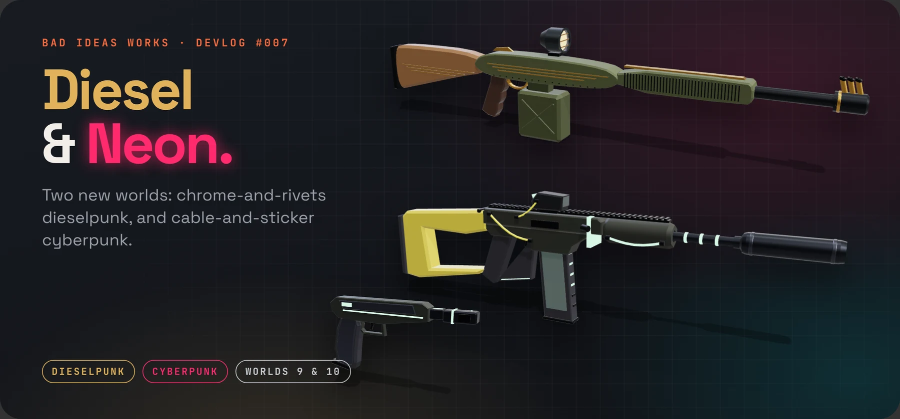

  

# 📓 The BadGun Devlog

> 📖 **Nicer to read on the website:** [badsadcode.github.io/BadGun/devlog](https://badsadcode.github.io/BadGun/devlog/)

Behind-the-scenes stories from building **BadGun**, a factory that designs weapons for video games. It's written for humans, not just programmers. Expect pictures, honesty, and the occasional trumpet.

| # | Entry | In one sentence |
|---|-------|-----------------|
| 007 | [**Diesel & Neon**](007-diesel-and-neon.md) | Two new worlds: chrome-and-rivets dieselpunk and cable-and-sticker cyberpunk. |
| 006 | [**Every Army Needs a Look**](006-every-army-needs-a-look.md) | Faction families: one lucky number, one whole matching arsenal. |
| 005 | [**Wood, Steel & History**](005-wood-steel-and-history.md) | Three new worlds from the 20th century: WW1, WW2 and the Vietnam era. |
| 004 | [**Runes, Crystals & a Lever**](004-runes-crystals-and-a-lever.md) | World #5 is fantasy, plus lever actions, machine pistols, hunting stocks and more. |
| 003 | [**Duct Tape, Double Barrels & Bows**](003-duct-tape-double-barrels-and-bows.md) | Every weapon gets its own shape, double barrels, a scavenger world, and the first bows. |
| 002 | [**Seven Weapons Walk Into a Factory**](002-seven-weapons-walk-into-a-factory.md) | Pistols, shotguns, snipers, machine guns, SMGs and crossbows. Plus an official statement regarding bees. |
| 001 | [**The Gun Factory Is Open**](001-the-gun-factory-is-open.md) | Day one: one rifle blueprint, three worlds, and a muzzle shaped like a trumpet. |

---

Made at **Bad Ideas Works**, where bad ideas receive suspiciously serious engineering.
